<div align="center">

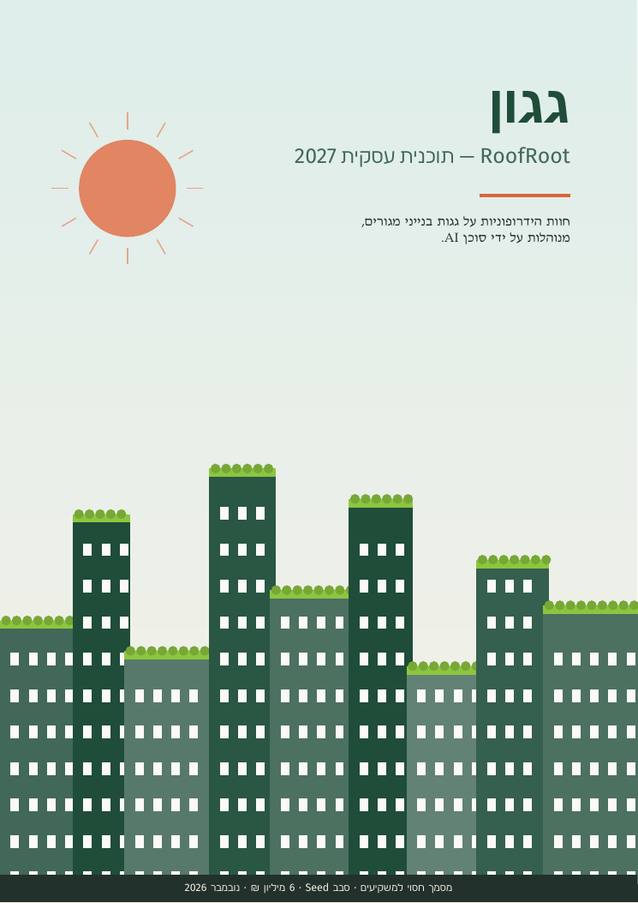

# 🌿 גגון · RoofRoot — תוכנית עסקית ב-LaTeX שנבנתה על ידי צוות סוכני AI

**מטלה 02 · קורס AI (L07) · אוניברסיטת בר-אילן · נובמבר 2026**
קוד קבוצה: `biu-rl555`

[📄 **ה-PDF המוגמר**](main.pdf) · [PRD](PRD.md) · [PLAN](PLAN.md) · [TODO](TODO.md) · [Prompts](prompts/) · [Skills](.claude/skills/) · [חקר אירועים](incidents/) · [דוחות צוות אדום](qa-reports/)

    

</div>

---

## מה יש כאן

**RoofRoot (גגון)** הוא מיזם בדיוני-מציאותי: חוות הידרופוניות על גגות בנייני מגורים בגוש דן, שמנוהלות על ידי סוכן AI בשם **RootOS**.
התוצר הוא תוכנית עסקית למשקיעים בעברית ובאנגלית, בהיקף 42 עמודים. היא **נבנתה כמו פרויקט תוכנה**, וכל מה שבה נוצר מקוד:

| | |
|---|---|
| 📐 **תבנית** | [`roofroot.cls`](roofroot.cls): תבנית מקורית עם גרסה ו-CHANGELOG. כוללת פלטת "גג ירוק", באנר עליון, פתיח פרק ב-TikZ ותיבות מידע |
| 📊 **גרפים** | 7 גרפים מ-Python ([`make_figures.py`](figures/python/make_figures.py)) שמחושבים מתוך **מודל פיננסי אמיתי** ([`model.py`](figures/python/model.py)) |
| 🎨 **איורים** | 7 איורי TikZ, כולל **שער מאויר בקוד**, BMC, SWOT וארכיטקטורה. **אפס תמונות מהאינטרנט** |
| 🔢 **מקור אמת יחיד** | כל מספר בטקסט הוא מאקרו (`\RRrevFinal`) שנוצר מ-`data/*.csv`. שינוי הנחה ב-CSV מעדכן את הגרפים, הטבלאות והטקסט ב-`make` אחד |
| 🤖 **צוות סוכנים** | Orchestrator, שלושה כותבים במקביל, ו-Detector ו-Fixer של צוות אדום. הכול מתועד ב-[prompts/](prompts/) |
| 🧪 **11 Skills** | 8 Skills של QA לפי דרישות המטלה, ועוד 3 לכתיבה ולאיורים: [.claude/skills/](.claude/skills/) |

## הצצה לדוח

<table>
<tr>
<td align="center">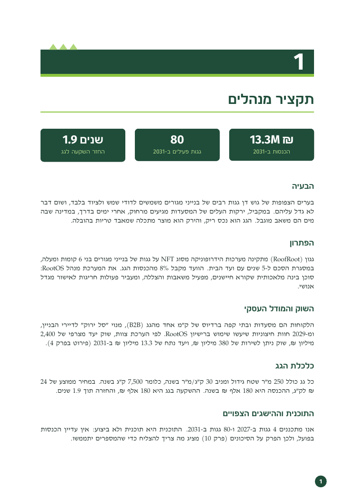<br/><sub>תקציר מנהלים</sub></td>
<td align="center">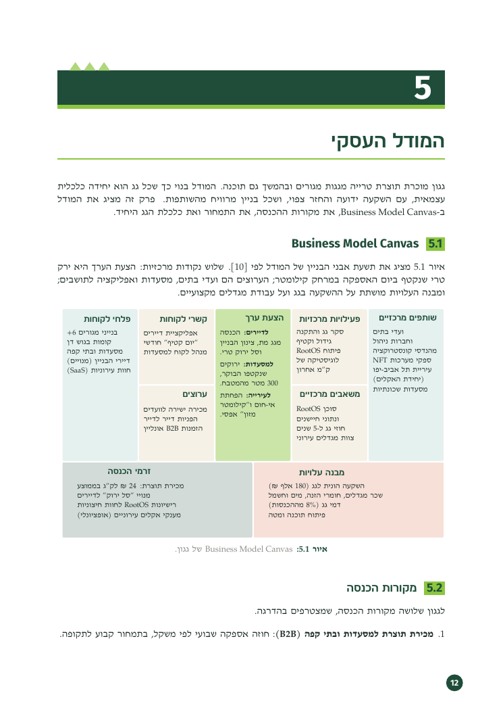<br/><sub>Business Model Canvas ב-TikZ</sub></td>
<td align="center">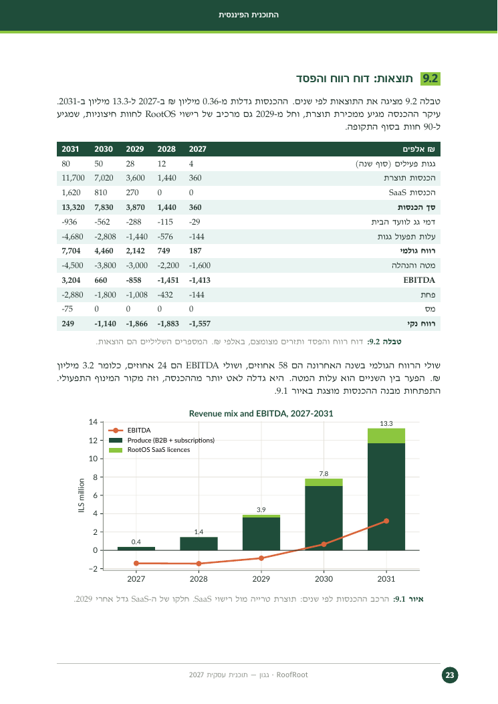<br/><sub>תוכנית פיננסית: טבלה אוטומטית</sub></td>
</tr>
<tr>
<td align="center">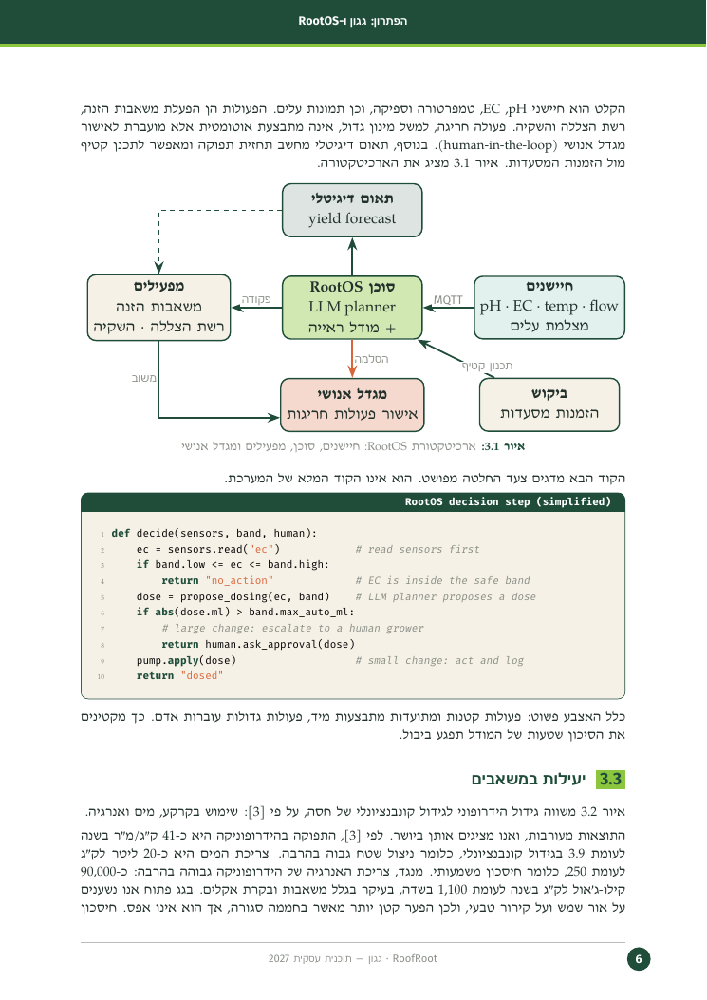<br/><sub>RootOS: ארכיטקטורה וקוד LTR</sub></td>
<td align="center">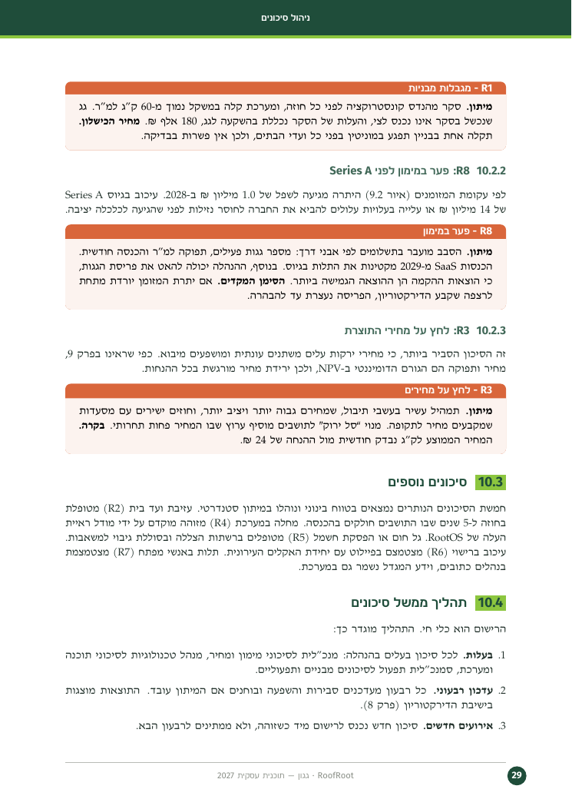<br/><sub>ניהול סיכונים</sub></td>
<td align="center">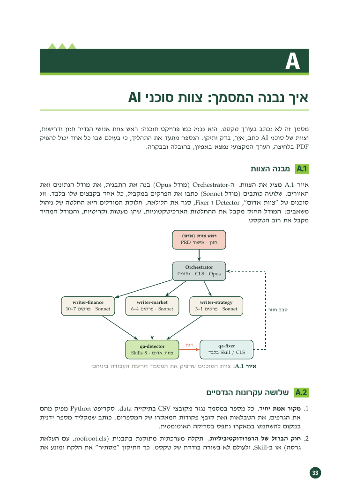<br/><sub>נספח: איך נבנה המסמך</sub></td>
</tr>
</table>

### הגרפים (Python → PDF וקטורי)

| | |
|---|---|
| 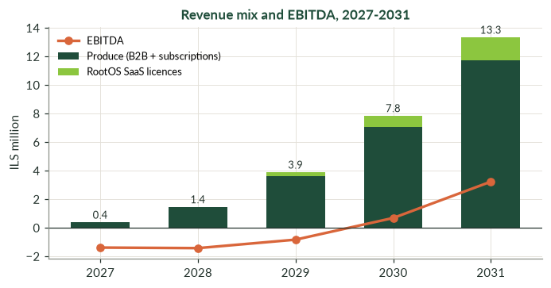 | 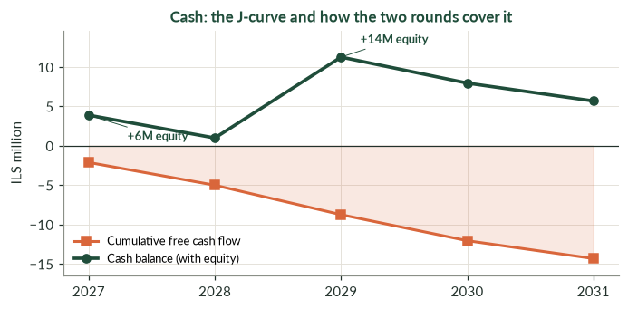 |
| 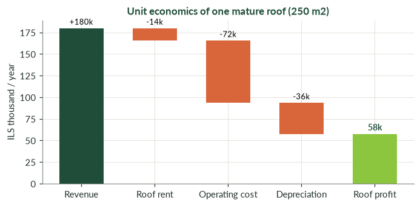 | 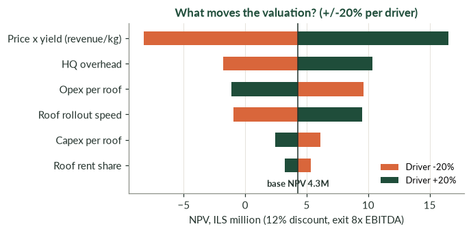 |

## צוות הסוכנים בפעולה

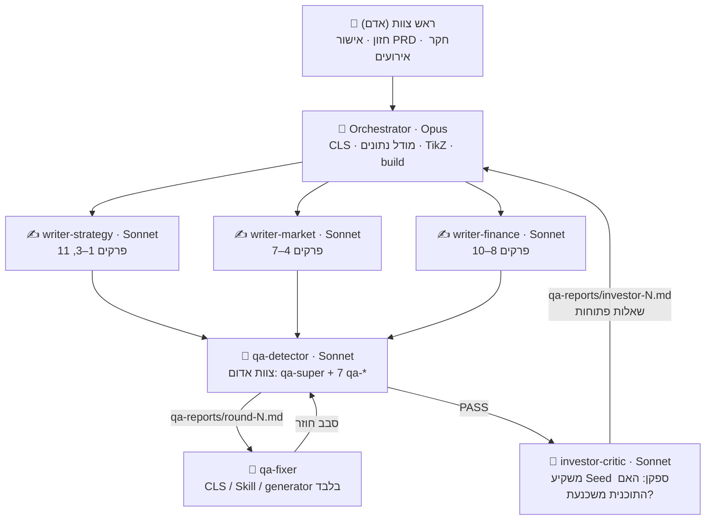

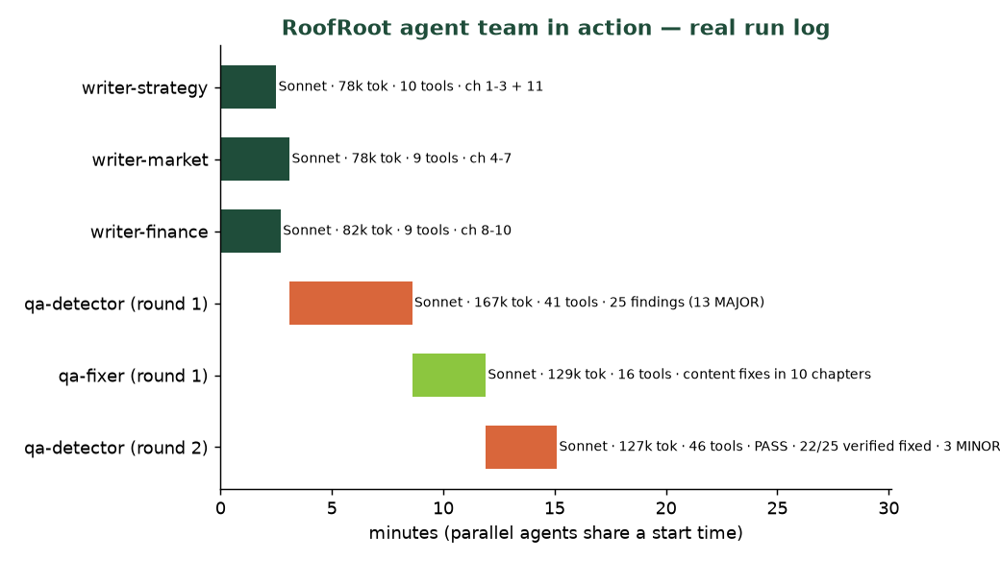

| סבב | סוכן | מודל | תוצאה |
|---|---|---|---|
| כתיבה (במקביל) | writer-strategy · writer-market · writer-finance | Sonnet ×3 | 11 פרקים בכ-3 דקות |
| צוות אדום 1 | qa-detector | Sonnet | **FAIL**: 25 ממצאים (13 MAJOR), כולל סוגרי ציטוט הפוכים, מספרים שסותרים את המודל וציטוט שלא תומך בטענה. [דוח מלא](qa-reports/round-1.md) |
| תיקון | Orchestrator (מערכתי) + qa-fixer (תוכן) | Opus + Sonnet | CLS v1.2, מחולל עם מאקרו לכל מספר נגזר, 10 פרקים מתוקנים |
| צוות אדום 2 | qa-detector | Sonnet | **PASS**: 22 מתוך 25 אומתו כמתוקנים, 0 MAJOR. [דוח](qa-reports/round-2.md) |

> **מה האדם תפס שהסוכנים פספסו:** כל המספרים במסמך (3.1 → "1.3") היו הפוכים, ואף סוכן לא דיווח על כך ([INC-004](incidents/INC-004-reversed-counters.md)). הסיבה: עמוד הבדיקה של התבנית הכיל רק "1.1", שנקרא אותו דבר בשני הכיוונים.

### כל 42 העמודים
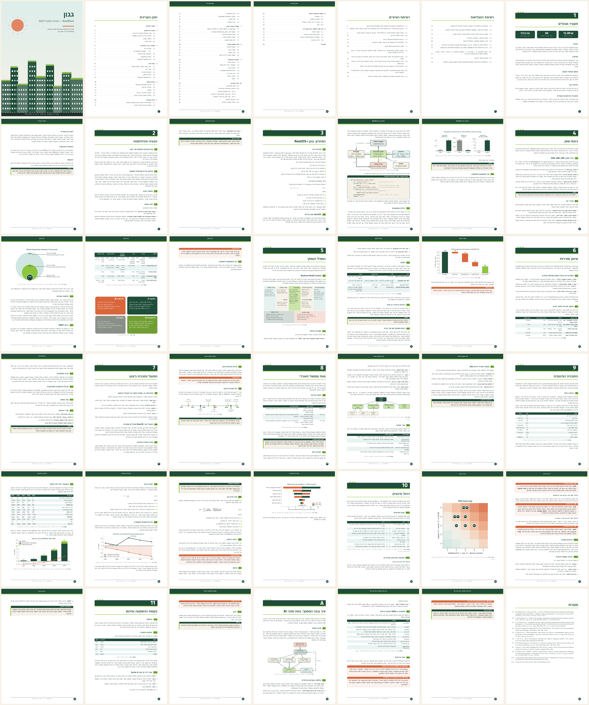

### לולאת הצוות האדום
1. **Detector** ([`qa-detector`](.claude/agents/qa-detector.md)) מריץ את [`qa_scan.py`](scripts/qa_scan.py) (בדיקות אוטומטיות של BiDi, מספרים, קוד, טבלאות, לוג ותשתית), עובר עמוד-עמוד על ה-PDF, וכותב דוח אל [`qa-reports/`](qa-reports/).
2. **Fixer** מתקן לפי **חוק הברזל**: תקלה מערכתית מתוקנת ב-CLS (עם העלאת גרסה), ב-Skill או במחולל, ולעולם לא בשורת טקסט בודדת.
3. **Investor-critic** ([`investor-critic`](.claude/agents/investor-critic.md), [פרומפט](prompts/07-investor-review.md)) נכנס אחרי PASS. הצוות האדום בודק שהמסמך *נכון*; הסוכן הזה בודק שהוא *משכנע*. הוא קורא את התוכנית כמו משקיע Seed שמחפש סיבה לסרב, נותן ציון לשישה היבטים (הבקשה, כלכלת יחידה, שוק, תחרות, סיכוני ביצוע, נרטיב), ומחזיר ל-Orchestrator ולכותבים את השאלות שנשארו בלי תשובה.
4. כל תקלה שעלולה לחזור מקבלת **חקר אירוע** ב-[`incidents/`](incidents/) עם ארבעה חלקים: מה קרה, למה, למה לא התגלתה, ומה השתנה.

## בנייה (רפרודוקטיביליות)

דרישות: TeX Live 2025+ או MiKTeX (LuaLaTeX ו-biber), ו-Python 3.10+. **לא נדרשים גופני מערכת**: Culmus, TeX Gyre ו-Fira מגיעים עם הפצת ה-TeX.

```bash
make venv     # once: .venv + matplotlib
make          # data → charts/tables/macros → lualatex → biber → lualatex ×2 → qa_scan
```

`scripts/check-chapter.sh 04-market` מקמפל פרק בודד בבידוד. כך כותבים מקבילים לא דורסים זה את ה-`aux` של זה.

## מבנה הפרויקט

```
├── main.tex                 # קובץ ראשי: שער, תוכן עניינים, \input לכל פרק, ביבליוגרפיה
├── roofroot.cls             # התבנית (גרסה + CHANGELOG)
├── references.bib           # 11 מקורות אמיתיים, IEEE
├── chapters/                # 11 פרקים + נספח, קובץ לכל פרק
├── data/                    # assumptions.csv · plan.csv · risks.csv  ← מקור האמת
├── figures/python/          # model.py (מודל פיננסי) · make_figures.py
├── figures/generated/       # fig_*.pdf/png · tab_*.tex · numbers.tex (נוצר אוטומטית)
├── figures/tikz/            # cover · bmc · swot · architecture · timeline · orgchart · agents
├── scripts/                 # build.sh · check-chapter.sh · qa_scan.py
├── .claude/skills/          # 11 Skills (qa-super, qa-BiDi, qa-table, qa-code, qa-img, qa-typeset, qa-infra, qa-cls-version, writer-he-en, fig-python, tikz-artist)
├── .claude/agents/          # chapter-writer · qa-detector · qa-fixer · investor-critic
├── prompts/                 # 7 קובצי פרומפט: ועדת מומחים → תשתית → כותבים → צוות אדום → מתקן → חקר אירוע → ביקורת משקיע
├── incidents/               # חקרי אירוע INC-001…
├── qa-reports/              # דוחות סבבי הצוות האדום
├── PRD.md · PLAN.md · TODO.md
└── main.pdf                 # התוצר
```

## החלטות עיצוב (ולמה)

| ברירת מחדל של LLM | מה בחרנו | למה |
|---|---|---|
| כחול-אפור תאגידי | ירוק יער, ליים, טרקוטה ושמנת | הצבעים *הם* המוצר: גג ירוק, אדמה ורעפים |
| עברית בגרפים | תוויות באנגלית, כיתובים בעברית | matplotlib לא מעצב RTL, ואותיות הפוכות נראות חובבניות |
| מספרים מוקלדים | מאקרו מ-CSV | גרף וטקסט לעולם לא סותרים זה את זה |
| גופני מערכת | Culmus, TeX Gyre ו-Fira מתוך TeX | אותו PDF בכל מחשב |
| `\textbullet` | ריבוע ליים ב-itemize | לגופן David CLM אין גליף של תבליט ([qa-BiDi B6](.claude/skills/qa-BiDi/SKILL.md)) |

---
<sub>כל הנתונים הפיננסיים הם הנחות מודל של מיזם בדיוני, לצורך המטלה. המקורות האקדמיים אמיתיים וניתנים לאימות (DOI).</sub>
